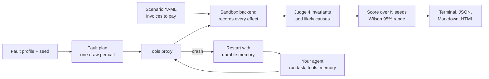

# agent-crashlab

Inject timeouts, lost replies, duplicate deliveries and crashes into an AI agent's tools, run it hundreds of times from fixed seeds, and count how often it pays an invoice twice, skips work or fails to resume.


▶ [Watch the 50-second demo video](https://github.com/sumankrsh/agent-crashlab/releases/latest/download/demo.mp4)

## The problem

An agent that calls real tools will meet real failures: a payment API that times out, a message queue that delivers the same request twice, a list endpoint that returns half a page, a worker that is killed halfway through a job. The usual first fix is to add retries. Retries make the agent finish more often, but they also create the most expensive failure: a timeout does not mean the call failed. If the payment went through and only the reply was lost, the retry pays the supplier a second time.

These failures don't show up in demos or in output-quality evals, because the agent's final answer can look fine while the ledger shows two payments. What a platform or risk team needs to know is: across many runs with realistic faults, how often does the agent do something twice, skip something, or fail to pick up where it left off after a crash?

`agent-crashlab` answers that by running the agent against a sandbox backend that records every side effect. Faults are injected per tool call from a seeded plan, so every run can be replayed exactly. Each run is judged by four invariants on the recorded effects (finished, complete, no duplicates, nothing unexpected), and the agent gets a reliability score with a confidence range across hundreds of seeds. It needs no API key and runs offline; 600 runs take under a second.

## Quickstart

```bash
git clone https://github.com/sumankrsh/agent-crashlab && cd agent-crashlab
pip install .
agent-crashlab run examples/agents/naive_agent.py examples/agents/retry_agent.py examples/agents/careful_agent.py
```

This runs three example agents against the built-in `month-end` scenario, a synthetic supplier payment run with nine invoices, six of them approved. Each agent must pay the six approved invoices and email each supplier a remittance note: 12 side effects, each exactly once. Each agent is run 200 times (seeds 1 to 200) with the `default` fault profile, plus one run with no faults as a baseline. The three agents are the same job written three ways:

| Agent | What it does | Clean runs |
|---|---|---:|
| [naive_agent.py](examples/agents/naive_agent.py) | No retries, no idempotency keys, no checkpoint. | 5 of 200 |
| [retry_agent.py](examples/agents/retry_agent.py) | Adds retries with backoff, the usual first fix. | 43 of 200 |
| [careful_agent.py](examples/agents/careful_agent.py) | Adds idempotency keys, a checkpoint in durable memory, and re-fetches partial pages (marked `FIX` in the file). | 200 of 200 |

The retry agent finishes every run, but in 75 runs it retried a payment whose reply was lost, in 69 a request delivered twice went through twice, and in 64 the restart after a crash redid finished work: 511 actions done twice and 1,151,714.50 overpaid across the 200 runs. The careful agent was crashed mid-run in 70 runs and resumed cleanly in all 70.

To see one run call by call:

```bash
agent-crashlab replay examples/agents/retry_agent.py --seed 3
```

The retry agent's payment for INV-1004 times out after it has gone through (a lost reply); it retries and pays 9,800.00 a second time. `agent-crashlab replay examples/agents/careful_agent.py --seed 4` shows the careful agent crash after paying INV-1007, restart, and have its repeated payment deduplicated by its idempotency key.

## Features

- **Six fault types**, drawn per tool call from a seeded plan:

  | Fault | Hits | What happens |
  |---|---|---|
  | `timeout` | reads, writes | The call times out before it reaches the backend. Nothing happens; the agent gets `ToolTimeout`. |
  | `lost_reply` | writes | The backend applies the effect, then the reply is lost. The agent gets `ToolTimeout` anyway. |
  | `error` | reads, writes | A transient error (503) before anything happens. The agent gets `ToolError` with `transient=True`. |
  | `duplicate` | writes | The request is delivered to the backend twice (at-least-once delivery). The agent sees one success. |
  | `partial` | reads | A list call returns half the page, marked `partial: true`, with the cursor still pointing past the full page. |
  | `crash` | writes | The agent's process dies right after the backend applies the effect. The run restarts with the agent's durable memory. |

- **Judged by side effects, not by output.** The sandbox backend records every payment and email. Each run is checked against four invariants: `finished` (the agent ran to the end, after any restarts, without giving up), `complete` (every expected effect happened), `no_duplicates` (nothing happened twice) and `no_unexpected` (no payment to a pending invoice, no wrong amount, no email to the wrong address).
- **The likely cause of every failure.** A duplicate payment is traced to the fault behind it: a retry after a lost reply, a duplicated request, or a restart after a crash. Failures are grouped into plain reasons such as "Did it twice: retried after a lost reply", each with a seed to replay.
- **A reliability score with a range.** The share of seeded runs in which every invariant held, with a 95% Wilson score interval, plus actions done twice, the total overpaid, and how many crashed runs resumed cleanly.
- **Reproducible.** The same agent, scenario, profile and seed give exactly the same calls, faults and effects. `agent-crashlab replay` shows one seed call by call.
- **A realistic backend.** `pay_invoice` and `send_email` honour an `idempotency_key` the way most payment APIs do: the same key with the same arguments returns the first result without doing anything again, and the same key with different arguments is rejected as a conflict. `list_payments` lets an agent check what has already been paid.
- **Fault profiles**: `default`, `flaky-network`, `crashy` and `none`, with any rate overridden by `--fault crash=0.1`.
- **Reports and CI**: terminal output, `--json`, `--markdown` (for a job summary) and `--html` (a single self-contained page), or all three with `--reports DIR`. `--min-score 0.95` makes the command exit 1 when an agent falls below the bar, or when it fails even with no faults injected. A [GitHub Actions example](examples/github-workflow.yml) is included.

## How it works



1. A fault-free baseline run checks that the agent does the job when nothing goes wrong. If it doesn't, the report says so and the run fails.
2. For each seed, a fresh backend is built from the scenario, and the agent is called as `run(task, tools, memory)`. Every tool call goes through a proxy that draws a fault from the seeded plan and applies it before or after the backend call, as the table above describes.
3. A crash raises `AgentCrashed`, which derives from `BaseException` so the agent's `except Exception` blocks can't swallow it. The harness then calls the agent again with the same `memory` object and the same backend, up to `--max-restarts` times. Local variables from the crashed attempt are gone.
4. After the run, the recorded effects are compared with what the scenario expects: one payment for the invoice amount and one remittance email to the supplier for each approved invoice.
5. The results of all seeds are scored and written out.

## Configuration

### Writing an agent to test

An agent is a Python function. It finds its work through the tools and can store anything that must survive a crash in `memory`, a dict:

```python
from agent_crashlab import ToolError, ToolTimeout


def run(task, tools, memory):
    # task.description: the job in plain English
    page = tools.list_invoices(status="approved", cursor=None)  # {items, next_cursor, partial}
    for inv in page["items"]:
        tools.pay_invoice(invoice_id=inv["id"], amount=inv["amount"], idempotency_key=f"pay-{inv['id']}")
    ...
```

Tools: `list_invoices(status=None, cursor=None)`, `get_invoice(invoice_id)`, `list_payments(invoice_id=None)`, `pay_invoice(invoice_id, amount, idempotency_key=None)` and `send_email(to, subject, body, idempotency_key=None)`. `tools.sleep(seconds)` backs off before a retry; time is simulated, so runs stay fast. Run `agent-crashlab tools` to list them.

Point the CLI at the agent as `path/to/file.py` (the function defaults to `run`), `path/to/file.py:function`, or `package.module:function`. To test an LLM-driven agent, give its tool functions bodies that call `tools.<name>(...)` and pass the exceptions through to the agent's own error handling.

### Scenarios

The built-in scenario is `month-end`. Write your own as YAML and pass it with `--scenario`; [examples/scenarios/quarter-end.yaml](examples/scenarios/quarter-end.yaml) has 18 invoices, 13 of them approved, in pages of 5:

```yaml
name: quarter-end-payables
task: >
  Pay every approved invoice for the amount on the invoice. After each payment,
  email the supplier a remittance note that quotes the invoice number.
page_size: 5
invoices:
  - {id: INV-2002, supplier: Brightwater Utilities, email: accounts@brightwater.example, amount: 5180.55, status: approved}
  - {id: INV-2001, supplier: Alder Joinery, email: accounts@alder.example, amount: 1224.95, status: pending}
```

`status` is `approved`, `pending` or `disputed`. A remittance email counts for an invoice when its subject or body contains the invoice number.

### crashlab.yaml

`agent-crashlab run` with no agents reads `crashlab.yaml` from the current folder (or the file given with `--config`). Paths in it are relative to the file. Command-line options override it.

```yaml
agents:
  - examples/agents/careful_agent.py:run
scenario: month-end          # built-in name, or a path to a scenario file
runs: 200
seed: 1
profile: default             # default, flaky-network, crashy or none
faults: {}                   # override single rates, e.g. {crash: 0.1}
max_restarts: 3
min_score: 0.95              # exit 1 below 95% reliability
reports: crashlab-report     # writes report.json, report.md and report.html
```

Run `agent-crashlab faults` to see every fault type, the rates in each profile and the invariants. Rates are per call; reads and writes are drawn separately, and the rates that apply to each must add up to 0.9 or less. At most one crash is injected per run.

Exit status: 0 when every agent passes (or no `min_score` is set and every baseline passes), 1 when an agent fails, 2 for a bad option, agent, scenario or config file.

## Limitations

- The sandbox is one domain: accounts payable, with five tools. It tests how an agent's control logic handles failures around side effects (retries, idempotency, checkpoints, pagination); it does not connect to your real tools. To test another domain you would need to write a new backend in Python; there is no plugin interface for that yet.
- Seeds reproduce the faults exactly, and runs are fully reproducible for deterministic agents like the examples. An agent that calls a real LLM will make different choices from run to run, so a replay may take a different path. The examples are rule-based so that the tool runs offline with no API key.
- Crashes are injected only after a write is applied, the hardest case. Crashes between calls or before a write are not modelled separately.
- Failure causes are a best guess from the recorded calls (for example, which fault hit the first of two identical payments). They are labelled as causes, not proof.
- The figures in this README come from running `agent-crashlab run examples/agents/naive_agent.py examples/agents/retry_agent.py examples/agents/careful_agent.py` on the bundled scenario with seeds 1 to 200: 5, 43 and 200 clean runs out of 200. The timing (600 runs in under a second) was measured on a Linux cloud machine with Python 3.11 and will vary. All invoice data, names and addresses are synthetic, using reserved `example` domains.

## More tools

Part of a small family of open-source tools for running AI with governance built in:

- **[ai-register](https://github.com/sumankrsh/ai-register)**: scans a codebase and keeps an AI inventory for EU AI Act and ISO/IEC 42001 reviews.
- **[mcp-gatekeeper](https://github.com/sumankrsh/mcp-gatekeeper)**: permissions, approvals and a tamper-evident audit log for MCP tool calls.
- **[enterprise-data-skills](https://github.com/sumankrsh/enterprise-data-skills)**: everyday data checks (SQL review, profiling, PII scans, model cards) for people and agents.
- **[agentbreak](https://github.com/sumankrsh/agentbreak)**: tests whether an attack makes an AI agent take an unauthorised action.
- **[prompt-ci](https://github.com/sumankrsh/prompt-ci)**: keeps prompts as owned, versioned and tested code, with a CI gate on changes.
- **[ai-policy-lint](https://github.com/sumankrsh/ai-policy-lint)**: checks agent configs, MCP configs and prompts against your company's AI policy.
- **agent-crashlab**: this tool, checking that an agent never does anything twice when its tools fail.

See [github.com/sumankrsh](https://github.com/sumankrsh) for newer tools.

## Credits

No code was adapted from other projects. Fault injection for LLM apps and agents is an active area: [agent-chaos](https://github.com/deepankarm/agent-chaos) injects LLM and tool failures into conversation scenarios and judges the results with evaluation frameworks, [agentic-chaos](https://github.com/DeepAgentLabs/agentic-chaos) is a broad fault-injection toolkit for LLM calls and workflows, and [balagan-agent](https://github.com/arielshad/balagan-agent) applies chaos engineering to agents. Use them for model and transport failures. agent-crashlab is narrower: it judges runs only by the side effects they leave behind, models the delivery failures that cause double actions (lost replies, duplicate delivery, crash after commit), and tests resume from durable memory. Idempotency keys as used here follow the common pattern documented by payment APIs. The confidence range is the Wilson score interval (Wilson, 1927).

## Licence

MIT. See [LICENSE](LICENSE).
